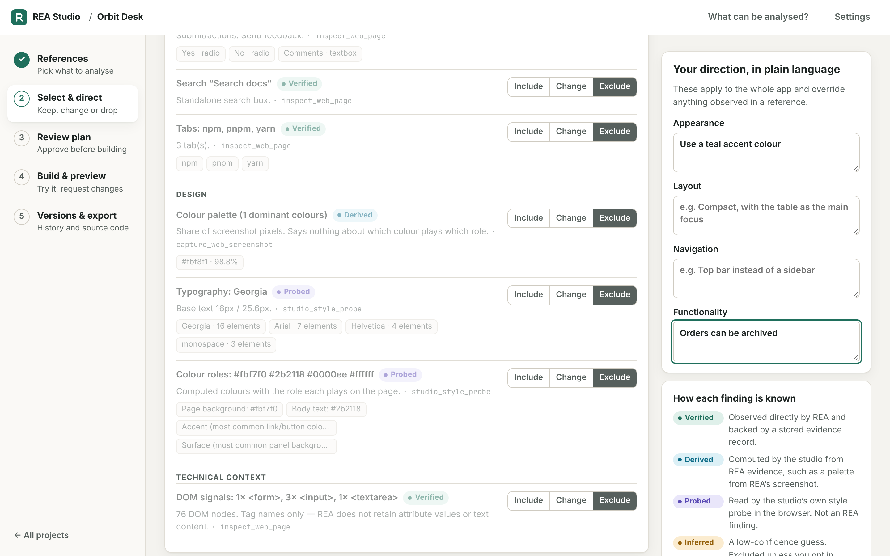
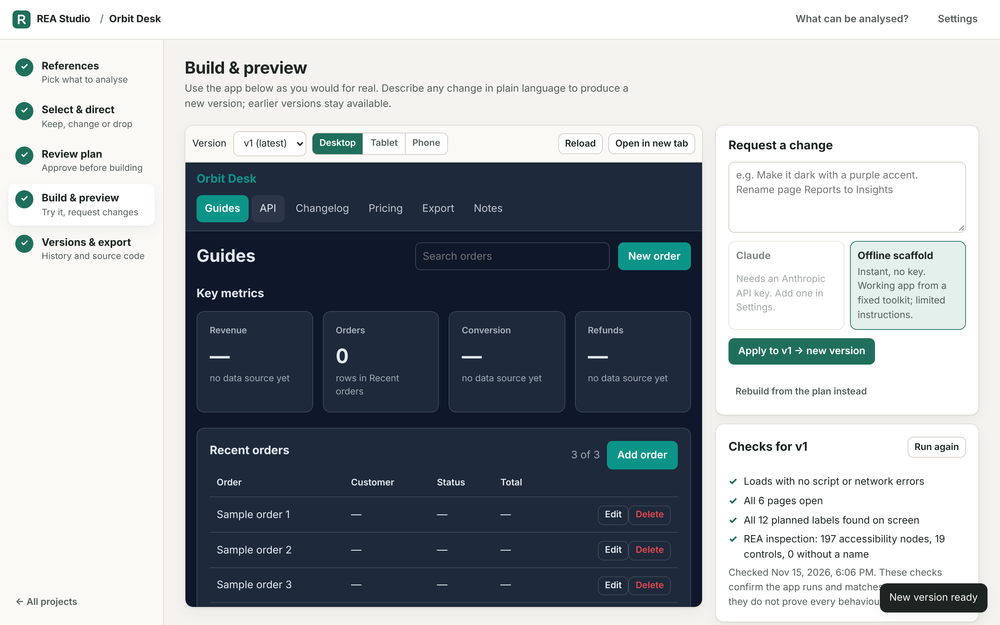

# REA Studio

A local graphical app that takes you from "I like how that software does X" to a working
application of your own. It uses [REA](https://github.com/morluto/rea) to investigate reference
software, shows you what it found and how it knows, lets you choose and redirect the parts you
want, and then builds, checks and refines the result with you.

REA Studio is an independent project built on REA. It is not part of, or endorsed by, the REA
project.





## Start it

Requires Node.js 22.23.4+ (the version REA needs) and a Chrome-family browser (Chrome, Chromium,
Edge or Brave).

```bash
npm install
```

```bash
npm start
```

The studio opens at http://127.0.0.1:4600. Use `npm start -- --port 4700` for another port, or
`--no-open` to stop it launching your browser.

## The workflow

1. **References** — add a website or web-app URL, a desktop application folder, or a plain
   description. Each is analysed separately. The form tells you straight away whether a target
   is supported and why not if it isn't.
2. **Select & direct** — every finding is listed with a provenance label. Mark each one
   *Include*, *Change* (say how, in your own words) or *Exclude*, and mix findings from different
   references. Four free-text boxes set the overall appearance, layout, navigation and
   functionality.
3. **Review plan** — the exact app that will be built: name, colours, navigation, pages and
   what goes on each, plus the assumptions being made. Edit it in place and add notes. Nothing is
   built until you approve.
4. **Build & preview** — the app runs in a live preview at desktop, tablet or phone size.
   Describe a change in plain language to get a new version. Every version is checked
   automatically.
5. **Versions & export** — preview, read the source of, or restore any version, and download
   it as a zip with a README and run instructions (`npm start`, no dependencies).

Projects are saved automatically in `./data` (set `REA_STUDIO_DATA` to move it).

## How findings are labelled

| Label | Meaning |
| --- | --- |
| **Verified** | Stated by REA Evidence. The raw evidence record is stored and linked. |
| **Derived** | Computed by the studio from REA Evidence, e.g. a colour palette from REA's screenshot. |
| **Probed** | Read by the studio's own style probe (fonts, colour roles, layout sizes). Not an REA finding — REA does not report CSS. Can be switched off in Settings. |
| **Inferred** | REA's own low-confidence inferences. Excluded unless you opt in. |
| **Described** | Typed by you. Nothing was inspected. |

Each reference also lists what was *not* observed, and every export contains a `PROVENANCE.md`
repeating all of this for the built app.

## Two build engines

- **Claude** — writes the application from the approved plan and follows any plain-language
  instruction or change request. Needs an Anthropic API key (Settings, or `ANTHROPIC_API_KEY`).
  It sends the plan, the selected findings and reference screenshots to the Anthropic API.
- **Offline scaffold** — instant, no key, sends nothing anywhere. Produces a working app
  (navigation, tables with add/edit/delete/sort/search, forms, tabs, record managers, charts,
  local persistence) from a fixed toolkit. It understands only a small vocabulary of
  instructions: theme words (dark, light, an accent colour or hex code, rounded, compact, serif),
  navigation placement, and renaming or removing pages. Anything else is listed as not applied
  rather than silently dropped.

## What it can and cannot analyse

See [docs/REA-CAPABILITIES.md](docs/REA-CAPABILITIES.md) for the full inspection of REA and the
gaps. In short:

- **Websites and web apps** — supported. One page state per reference; add more URLs for more
  pages. For pages behind a sign-in, turn off "Run the analysis browser hidden" in Settings, sign
  in, and analyse again.
- **Electron / JavaScript desktop apps** (folder or `.asar`) — supported by static analysis:
  windows, IPC channels, renderer APIs, routes. The app is never run, so its look is not observed.
- **Other installed desktop apps** — the runtime family is identified, nothing more.
- **Native binaries, installers, Android packages** — not turned into features. Describe them
  as a manual reference instead.

## Responsible use

Only analyse software you own or are authorised to examine; licences and local law may restrict
reverse engineering. The studio rebuilds structure and behaviour with original code. It does not
copy a reference's source code, text, data, branding or assets, and the Claude engine is
instructed not to either. REA's own [disclaimer](https://github.com/morluto/rea/blob/main/DISCLAIMER.md)
applies to its use here.

## Development

```bash
npm test
```

Runs the end-to-end pipeline against fixture sites and a fixture Electron app using real REA and
a real browser, and exercises the Claude engine against a local stand-in for the API.

```
bin/studio.mjs            entry point
server/rea.mjs            REA CLI wrapper
server/browser.mjs        studio-owned browser + minimal CDP client
server/analyze.mjs        runs REA per reference, records evidence and gaps
server/findings.mjs       REA Evidence → labelled, selectable elements
server/plan.mjs           selections + directions → reviewable plan
server/generate/          Claude engine, offline scaffold, export packaging
server/verify.mjs         automated check of each version (studio + REA)
web/                      the GUI (no build step)
```
